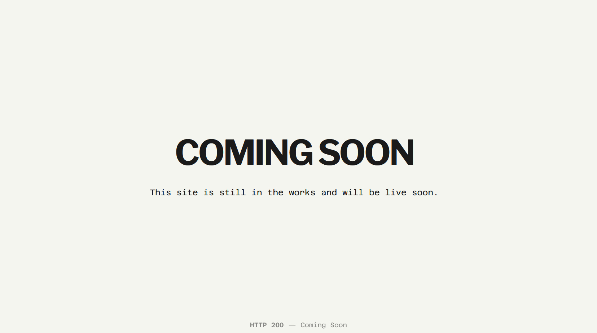
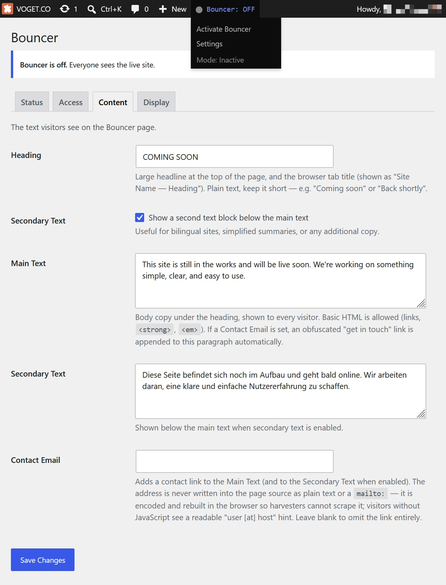

<h1 align="center"></h1>

<p align="center">Maintenance mode and coming soon pages for WordPress, done the way search engines expect.</p>

<p align="center">
  
  
  
</p>

## Features

### Done right for search engines
- **Two modes with the correct status code.** *Maintenance* answers `503 Service Unavailable` with a `Retry-After` header, so search engines keep your rankings and come back later. *Coming Soon* answers `200` for a site that hasn't launched yet.
- **Nothing gets indexed while the gate is on.** Bouncer serves a strict `robots.txt` (`Disallow: /`), sends `X-Robots-Tag: noindex, nofollow` and adds a `noindex` meta tag.
- **Out of the way when it's off.** `robots.txt` and SEO go back to WordPress or your SEO plugin.

### Show the site before launch
- **Named preview links.** One link per client or team, each with its own expiry (1 hour to 30 days, or none), open count and last-opened time. Deactivate a link to cut access but keep the record, or delete it.
- **IP allowlist** for your office or agency network, with a one-click "add my IP".
- **Logged-in users always see the live site.**

### Easy to run
- **One-click on/off** from the admin bar, with the current status always visible.
- **Your own words on the page.** Heading, main text, an optional second text block (great for bilingual sites) and a contact email that spam harvesters can't scrape.
- **Light and dark.** The page follows the visitor's system setting, with an optional toggle and an optional button to another website.
- **A clear settings page** in four tabs: Status, Access, Content, Display.
- **Lightweight.** Three PHP files. No account, no tracking, no upsells.

## Screenshots

<p align="center"><br><em>What visitors see (Coming Soon mode)</em></p>

<p align="center"><br><em>Settings → Bouncer, Content tab</em></p>

## Requirements

- WordPress 6.6 or later
- PHP 8.1 or later

## Installation

1. Download the latest `bouncer.zip` from [Releases](https://github.com/mvgt13/bouncer/releases), or copy the `bouncer/` folder from this repository.
2. In WordPress, go to **Plugins → Add New → Upload Plugin** and upload the zip, or put the `bouncer/` folder into `wp-content/plugins/`.
3. Activate **Bouncer** under **Plugins**.
4. Configure it under **Settings → Bouncer**.

Bouncer does not update itself from wordpress.org (`Update URI: false`). To update, replace the plugin folder with a newer release.

## Settings

The settings page has four tabs: **Status**, **Access**, **Content** and **Display**. A notice at the top shows whether Bouncer is on and what visitors see.

### Status

| Option | Description |
|---|---|
| Enable Bouncer | Gate the front end. While on, only logged-in users, allowed IPs and preview-link holders reach the live site. A strict `robots.txt` and `noindex` headers are served. |
| Mode | Maintenance (503, for an existing indexed site that is temporarily down) or Coming Soon (200, for a site that hasn't launched yet). Neither is indexable while gated. |
| Retry After | `Retry-After` value on the 503: a hint for how long search engines should wait before checking again. Maintenance mode only. |

### Access Control

| Option | Description |
|---|---|
| New Link Duration | How long newly created links stay active: 1h, 6h, 24h, 3d, 7d, 30d or no expiry. Does not affect existing links. |
| Preview Links | Table of all named preview links. Create, copy, deactivate or delete individual links. |
| Allowed IPs | One IP per line. These visitors always see the live site, whatever the Bouncer status. The tab shows your current IP with a button to add it. |

**Link status**

- **Active** (green): the link is valid and has been opened at least once
- **Active, not opened yet** (grey): the link is valid but nobody has used it yet
- **Expired** (yellow): the link passed its expiry date
- **Deactivated** (grey): an admin deactivated the link

**Notes**

- "No expiry" links set browser cookies capped at 14 days, so no visitor keeps permanent access by cookie. The link itself stays valid until you deactivate or delete it.
- The open counter only counts a visitor's first arrival (without a valid cookie), so page refreshes don't inflate it.

### Content

| Option | Description |
|---|---|
| Heading | Large display text |
| Main Text | Body copy shown to all visitors |
| Secondary Text | Optional second text block below the main text, for bilingual sites, short summaries or extra copy |
| Contact Email | Linked in the page copy and obfuscated in the HTML source. Leave blank to omit it. |

### Display

| Option | Description |
|---|---|
| Dark Mode Toggle | Show a dark/light mode switch |
| Website Button | Show a button linking to an external URL |
| Website URL | Target URL for the website button |

## Files

```
bouncer/
  bouncer.php            # Plugin entry point, admin UI, bypass logic
  bouncer-template.php   # Visitor-facing page template
  uninstall.php          # Removes all bouncer_* options when the plugin is deleted
```

## Open points

Planned for a future release, not built yet:

- **Preview tab.** A fifth settings tab that shows the Bouncer page as visitors will see it, including unsaved changes on the Content and Display tabs, without turning the gate on.
- **Design the page in the block editor.** Build the visitor page with the WordPress block editor instead of the fixed template, so it can carry your own layout, images and branding. The current template stays the default.

## Changelog

See [CHANGELOG.md](CHANGELOG.md).

## License

Bouncer is free software, licensed under the [GNU General Public License v2.0 or later](LICENSE).

Made by [VOGET.CO](https://voget.co).
